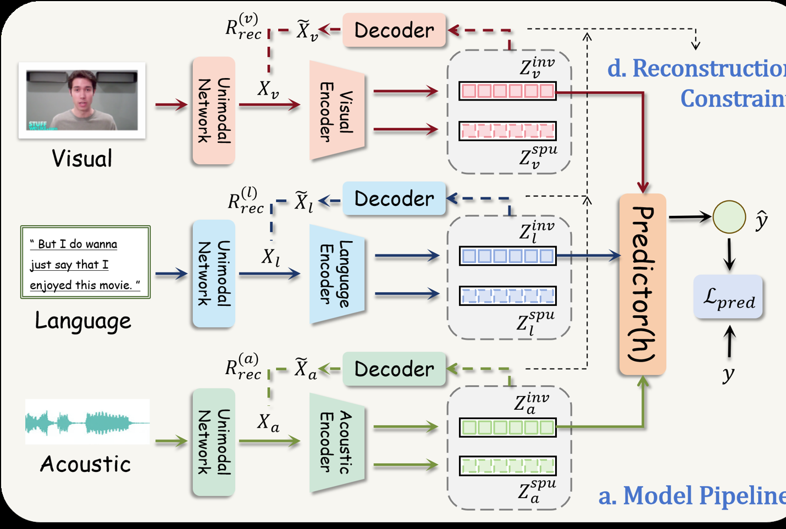

# CmIR: Causal modality-Invariant Representation

Official PyTorch implementation of the ACL 2026 paper:

> **Learning Invariant Modality Representation for Robust Multimodal Learning from a Causal Inference Perspective**
> Sijie Mai, Shiqin Han
> *Proceedings of the 64th Annual Meeting of the Association for Computational Linguistics (ACL 2026, Long Papers)*

CmIR learns robust multimodal representations from a **causal inference** perspective. Each modality is disentangled into an **invariant (causal)** component and an **environment-specific (spurious)** component, so that prediction relies only on the causal features that remain stable across environments.



## Method

For every modality \(m \in \{l, a, v\}\), an encoder \(g_m\) maps the unimodal feature \(X_m\) to a pair \((Z_m^{inv}, Z_m^{spu})\), a decoder \(r_m\) reconstructs \(X_m\), and a shared predictor \(h\) fuses the invariant representations of all modalities to predict the target \(Y\). The model is trained with three complementary constraints (paper Eq. 9):

\[
\mathcal{L} = \mathcal{L}_{pred} + \lambda_1 \sum_m \mathcal{R}_{inv}^{(m)} + \lambda_2 \sum_m \mathcal{R}_{dec}^{(m)} + \lambda_3 \sum_m \mathcal{R}_{rec}^{(m)}
\]

1. **Invariance constraint \(\mathcal{R}_{inv}\) (Eq. 3–4).** We build \(K\) virtual environments by injecting Gaussian noise with coefficient \(\alpha^{(e)} = e \cdot \alpha^{(1)}\), and enforce the invariant representations of every environment pair to be identical (element-wise \(L_1\) distance for regression).
2. **Mutual-information constraint \(\mathcal{R}_{dec}\) (Eq. 5–6).** Mutual information \(I(Z_m^{inv}; Z_m^{spu})\) is approximated by an orthogonality loss on the cross-correlation matrix, pushing the two components toward statistical independence.
3. **Reconstruction constraint \(\mathcal{R}_{rec}\) (Eq. 7–8).** An MSE term ensures \((Z_m^{inv}, Z_m^{spu})\) retains all information of the raw input \(X_m\).

## Requirements

- Python 3.9
- PyTorch 1.13.1 (CUDA 11.6)
- transformers 4.29.2
- numpy, scikit-learn, tqdm

Install dependencies with:

```bash
pip install -r requirements.txt
```

## Datasets

CmIR is evaluated on **CMU-MOSI** and **CMU-MOSEI** for multimodal sentiment analysis, with pre-extracted language / acoustic / visual features (see paper Appendix C and E).

Place the pickled datasets under `datasets/`:

```
datasets/
├── mosi.pkl
└── mosei.pkl
```

Each pickle is a dictionary with `"train"`, `"dev"`, and `"test"` splits. Every example has the form

```
((words, visual, acoustic), label_id, segment)
```

where `words` is a list of tokens, `visual` / `acoustic` are `np.ndarray` of shape `(num_frames, feature_dim)`, and `label_id` is a sentiment score on the \([-3, 3]\) scale. The unimodal feature dimensions used by the code are:

| Dataset | Language | Acoustic | Visual |
|---|---|---|---|
| CMU-MOSI | 768 | 74 | 47 |
| CMU-MOSEI | 768 | 74 | 35 |

## Pretrained Language Model

Download [DeBERTa-v3-base](https://huggingface.co/microsoft/deberta-v3-base) from Hugging Face. The trainer loads it from the path given by `--model` (the default `microsoft/deberta-v3-base` is resolved automatically when cached). To use a local copy, point `--model` to the folder containing the model files.

## Training and Evaluation

The single entry point `train.py` supports both datasets. The model selected by the best validation loss is reported with the full test metric set.

**CMU-MOSI**:

```bash

python train.py   --dataset mosi --n_epochs 100 --train_batch_size 48 --learning_rate 1e-5   --num_of_envs 4 --noise_scale 0.2   --lambda1 0.01 --lambda2 0.01 --lambda3 0.01   --share_dim 150 --inter_dim 150 --weight_decouple 1.0
```

**CMU-MOSEI**:

```bash
python train.py   --dataset mosei --n_epochs 10 --train_batch_size 32 --learning_rate 1e-5   --num_of_envs 3 --noise_scale 0.1   --lambda1 0.01 --lambda2 0.01 --lambda3 0.01   --share_dim 120 --inter_dim 128 --weight_decouple 0.1
```

Add `--save_features` to store the extracted invariant representations and fused features as `.npy` files.

## Out-of-Distribution Noisy-Modality Testing

To reproduce the noisy-modality experiments (paper Table 4), corrupt the **test** inputs with `--noise_type` and a noise rate `NR` ranging from 0.1 to 0.7:

```bash
# Gaussian noise (Eq. 14): X' = (1 - NR) X + NR * N
python train.py --dataset mosi --noise_experiment 1 --noise_type 1 --percent2 0.3

# Laplace noise or random erasing (selected with equal probability)
python train.py --dataset mosi --noise_experiment 1 --noise_type 2 --percent 0.5
```

Set `--noise_type 0` (default) to run on clean data.

## Evaluation Metrics

Following the standard multimodal sentiment protocol, the code reports:

- **Acc7 / Acc2**: seven-class and binary accuracy,
- **F1**: binary weighted F1 score,
- **MAE**: mean absolute error (lower is better),
- **Corr**: Pearson correlation coefficient.

Neutral (zero-label) segments are excluded from the binary Acc2, F1, MAE, and Corr calculations.

## Code Structure

```
CmIR/
├── train.py              # Unified training / evaluation entry (MOSI & MOSEI)
├── model_cmir.py         # CmIR model: encoders, decoders, predictor, constraints
├── global_configs.py     # Feature dimensions and device configuration
├── modules/              # Transformer encoder (adapted from fairseq / MulT)
│   ├── transformer.py
│   ├── multihead_attention.py
│   └── position_embedding.py
├── tests/
│   └── test_losses.py    # Unit tests for the constraint losses
├── datasets/             # Put mosi.pkl / mosei.pkl here
├── assets/               # README figures
└── requirements.txt
```

## Unit Tests

Run the lightweight loss tests (no pretrained-model download required):

```bash
python -m tests.test_losses -v
```

## Citation

If you find this code useful, please cite our paper:

```bibtex
@inproceedings{mai2026cmir,
  title     = {Learning Invariant Modality Representation for Robust Multimodal Learning from a Causal Inference Perspective},
  author    = {Mai, Sijie and Han, Shiqin},
  booktitle = {Proceedings of the 64th Annual Meeting of the Association for Computational Linguistics (Volume 1: Long Papers)},
  pages     = {45698--45721},
  year      = {2026}
}
```

## Acknowledgements

We thank the authors of [ITHP](https://github.com/joshuaxiao98/ITHP) and [BERT Multimodal Transformer](https://github.com/WasifurRahman/BERT_multimodal_transformer) for sharing their code, and the fairseq / MulT projects for the transformer modules.
